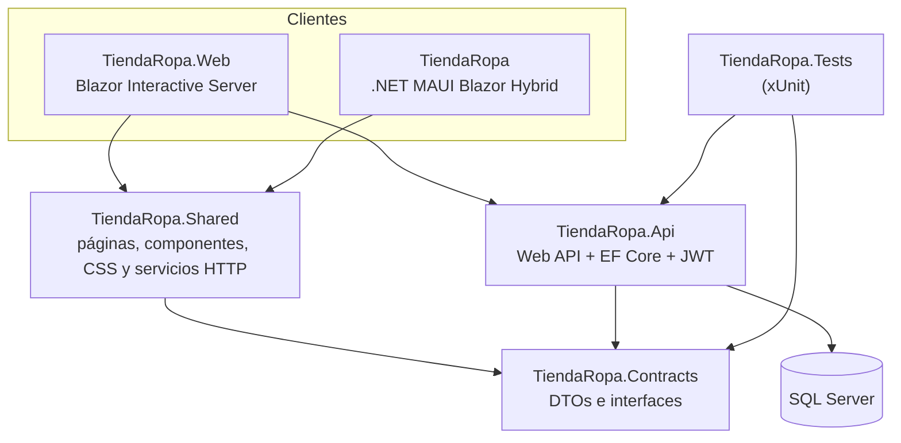
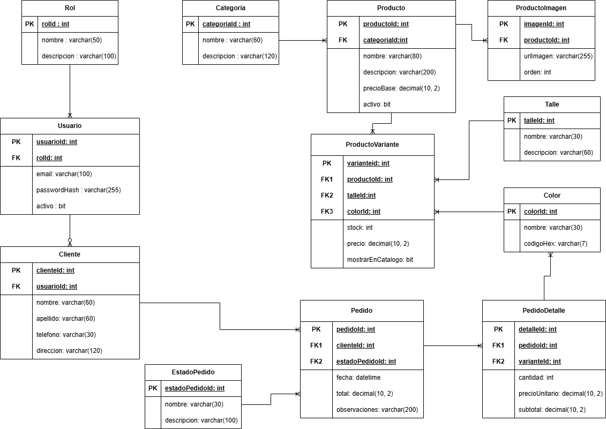
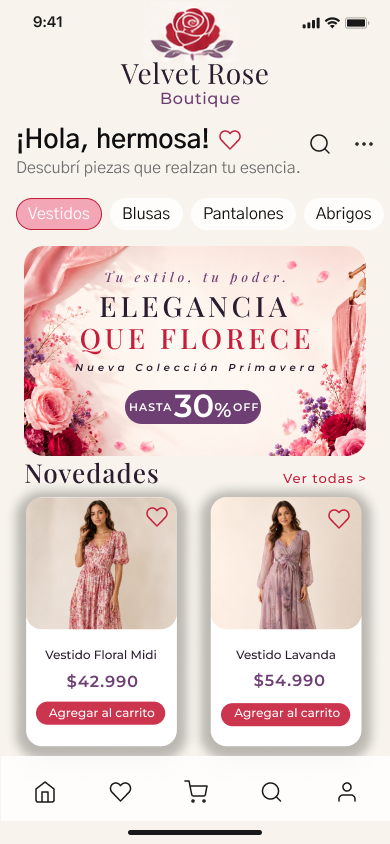
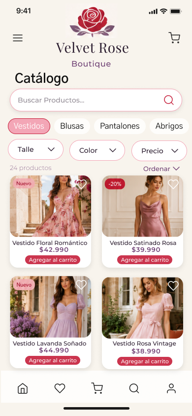
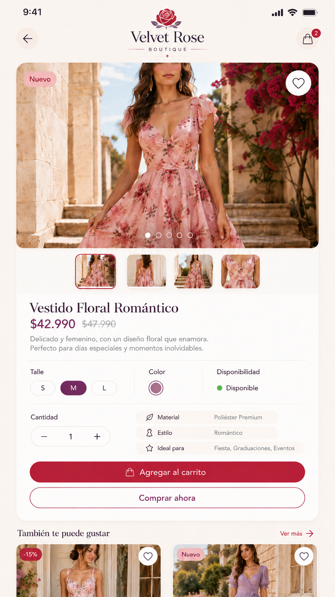
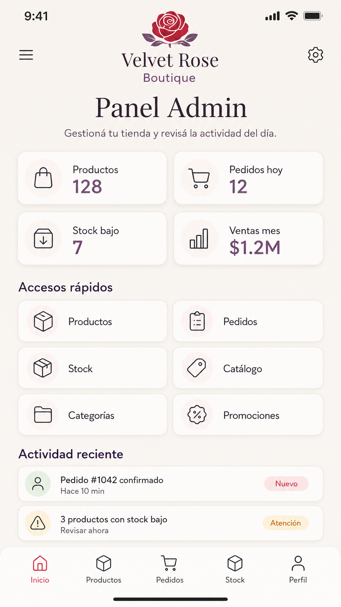

# Velvet Rose Boutique — [tiendaropa2026.runasp.net](https://tiendaropa2026.runasp.net/)

Tienda de ropa online con catálogo, variantes por talle y color con stock independiente,
carrito, pedidos con descuento atómico de stock, panel de administración y asistente de
atención al cliente. La misma interfaz —compartida en `TiendaRopa.Shared`— corre en la
**web (Blazor)** y en una **app .NET MAUI Blazor Hybrid** (Android, Windows, iOS y
MacCatalyst).

---

## Acceso de demostración

| Perfil | Usuario | Contraseña |
|---|---|---|
| Administrador | `admin@velvetrose.dev` | compartida por email|
| Cliente | `cliente@velvetrose.dev` | compartida por email |

---

## Índice

- [Descripción del proyecto](#descripción-del-proyecto)
- [Tecnologías](#tecnologías)
- [Arquitectura y proyectos](#arquitectura-y-proyectos)
- [Organización de carpetas](#organización-de-carpetas)
- [Diagramas DER](#diagramas-der)
- [Web y aplicación móvil](#web-y-aplicación-móvil)
- [API y datos](#api-y-datos)
- [Asistente Gemini](#asistente-gemini)
- [Ejecución local](#ejecución-local)
- [Despliegue](#despliegue)
- [Recursos visuales](#recursos-visuales)
- [Estado y limitaciones](#estado-y-limitaciones)

---

## Descripción del proyecto

Velvet Rose Boutique resuelve el problema de un comercio de ropa que necesita vender
online sin sobreventa: cada producto tiene variantes (talle + color) con **stock
propio**, y el pedido descuenta ese stock de forma transaccional. El sistema cubre el
catálogo público, la venta, la gestión interna de la tienda y la atención al cliente.

**Visitante (sin cuenta)**

- Navega el inicio y el catálogo, busca y filtra por categoría, talle, color y precio,
  y ordena los resultados.
- Ve la ficha de cada producto: galería de imágenes, variantes reales con stock,
  precio y selector de cantidad.
- Arma un carrito (persistido en el navegador); para confirmar el pedido necesita una
  cuenta.
- Consulta el asistente conversacional sin iniciar sesión: las herramientas que tocan
  pedidos o datos personales piden sesión, y la identidad siempre sale del JWT.

**Cliente (rol `Cliente`)**

- Se registra e inicia sesión (JWT) y confirma su pedido: el carrito pasa a `Pedido`
  y el stock se descuenta dentro de una transacción.
- Consulta su historial, el detalle y las notas de seguimiento de sus pedidos, y
  cancela los que todavía corresponden.
- Habla con el asistente conversacional, envía solicitudes de atención (consulta de
  pedido, reposición, consulta general) con confirmación explícita y lee las
  respuestas del personal.

**Personal de tienda (roles `Vendedor` y `Administrador`)**

- `/admin/pedidos`: listado, detalle, cambio de estado con transiciones válidas,
  publicación de notas de seguimiento.
- `/admin/solicitudes`: notificaciones internas con contador, respuesta y cierre de
  solicitudes.
- `/admin/productos` y `/admin/catalogos` (**sólo Administrador**): alta, edición y
  baja lógica de productos, variantes con stock, imágenes (hasta 5 por producto),
  categorías, talles y colores.

La autorización se decide siempre en el backend: la UI sólo evita mostrar acciones
que el usuario no puede realizar.

---

## Tecnologías

Versiones verificadas en los `.csproj` de la solución:

| Área | Tecnología |
|---|---|
| Plataforma | .NET 10 (`net10.0`, `net10.0-android`, `net10.0-ios`, `net10.0-maccatalyst`, `net10.0-windows10.0.19041.0`) |
| Backend | ASP.NET Core Web API con controladores, `Microsoft.AspNetCore.OpenApi` 10.0.12 y UI Scalar 2.17.10 (sólo en Development) |
| Frontend web | Blazor Web App con renderizado **Interactive Server** (servidor + circuito; no se usa WebAssembly interactivo) |
| App móvil / escritorio | .NET MAUI **Blazor Hybrid** (`BlazorWebView`), empaquetado como app única |
| Componentes | Razor Class Library (`Microsoft.AspNetCore.Components.Web` 10.0.0) |
| Datos | Entity Framework Core 10.0.12 (`Microsoft.EntityFrameworkCore.SqlServer`) sobre **SQL Server** |
| Autenticación | JWT Bearer 10.0.12 (token simétrico HS256) + contraseñas con `PasswordHasher` (PBKDF2) |
| Asistente IA | `Google.GenAI` 2.1.0 — Gemini con *Function Calling* |
| Pruebas | xUnit 2.9.3, `Microsoft.EntityFrameworkCore.InMemory` 10.0.12, coverlet 6.0.4; Playwright ^1.63.0 para las suites web |
| Estilo | CSS propio con design tokens (`velvet-tokens.css`), tipografías **Playfair Display** e **Inter** alojadas localmente e iconos **Material Symbols Outlined** (woff2 en `TiendaRopa.Shared/wwwroot/fonts`) |

---

## Arquitectura y proyectos

Seis proyectos en `TiendaRopa.slnx`:

| Proyecto | Qué es | Responsabilidad |
|---|---|---|
| `TiendaRopa.Web` | Blazor Web App (`Microsoft.NET.Sdk.Web`) | Host web: renderiza la UI en modo *Interactive Server*, hospeda la API en el mismo proceso y sirve `/img/*`. Persiste las claves de Data Protection fuera de `wwwroot`. |
| `TiendaRopa` | .NET MAUI Blazor Hybrid (`UseMaui`, salida ejecutable) | App Android / iOS / MacCatalyst / Windows: `MainPage.xaml` monta un `BlazorWebView` cuya raíz es `TiendaRopa.Shared.Routes`. Aporta los servicios de plataforma (selector de imágenes de galería o explorador) y la URL base de la API por plataforma (`ConfiguracionApp.cs`). |
| `TiendaRopa.Api` | ASP.NET Core Web API | Controladores, EF Core + SQL Server, autenticación y autorización (JWT, roles y permisos), reglas de pedido/stock, seeders, imágenes de producto y el asistente Gemini. |
| `TiendaRopa.Shared` | Razor Class Library | Toda la UI compartida: páginas y rutas, componentes reutilizables, layout, CSS/tokens/JS/fuentes, servicios HTTP, sesión JWT y carrito. Sólo consume abstracciones (`IPreferenciasLocal`, `ISelectorImagenes`, `IResolverImagenes`). |
| `TiendaRopa.Contracts` | Class library sin dependencias | DTOs e interfaces (`ICatalogoService`, `IAuthService`, `IPedidoService`, `IAdminService`, `IChatService`, `ISolicitudService`, `INotificacionService`). Es la **única** biblioteca que comparten la API y los clientes. |
| `TiendaRopa.Tests` | Proyecto de pruebas xUnit | Pruebas de la lógica del asistente, herramientas, solicitudes e imágenes de producto con EF Core *in memory* (no toca SQL Server). |



Reglas que sostiene el código:

- La API **no** referencia `TiendaRopa.Shared`: sólo `TiendaRopa.Contracts`.
- El frontend nunca recibe entidades de EF Core, sólo DTOs.
- `TiendaRopa.Shared` no referencia APIs de MAUI ni del navegador: cada host registra
  sus propias implementaciones.

---

## Organización de carpetas

```text
TiendaRopa/
├── TiendaRopa.slnx                 # Solución (.NET 10)
├── TiendaRopa/                     # App .NET MAUI Blazor Hybrid
│   ├── MauiProgram.cs              # DI: servicios HTTP, sesión, carrito, chat
│   ├── MainPage.xaml               # BlazorWebView → shared:Routes
│   ├── ConfiguracionApp.cs         # URL base de la API por plataforma
│   ├── Platforms/  Resources/      # Android, Windows, iOS, MacCatalyst / iconos, fuentes
│   └── Services/                   # Selector/resolución de imágenes nativas
├── TiendaRopa.Shared/              # UI y lógica compartida (Razor Class Library)
│   ├── Components/                 # AppButton, AppIcon, ProductCard, ChatBot, etc.
│   ├── Pages/                      # Home, Catalogo, DetalleProducto, Carrito, Login…
│   │   └── Admin/                  # AdminIndex, AdminProductos, AdminPedidos, AdminSolicitudes…
│   ├── Layout/                     # MainLayout (navegación mobile-first)
│   ├── Services/                   # HttpCatalogoService, SesionService, CarritoService…
│   ├── Models/  Samples/
│   ├── wwwroot/                    # css/ (tokens), js/, fonts/ (Material Symbols, Inter…)
│   └── Routes.razor
├── TiendaRopa.Web/                 # Host web Blazor
│   ├── Program.cs                  # Interactive Server + hospedaje de la API
│   ├── Components/                 # App.razor, Layout/, Pages/Error.razor
│   └── Services/                   # Selector/resolución de imágenes web
├── TiendaRopa.Api/                 # Backend
│   ├── Controllers/                # productos, categorías, auth, pedidos, admin, asistente…
│   ├── Auth/                       # TokenService, Roles, Permisos, UsuarioActual
│   ├── Asistente/                  # integración con Gemini y herramientas
│   ├── Data/                       # DbContext, Migrations/, seeders
│   ├── Entities/  Services/
│   └── ApiIntegration.cs           # AddVelvetRoseApi / UseVelvetRoseApiAsync
├── TiendaRopa.Contracts/           # DTOs e interfaces compartidos
│   ├── Catalogo/  Identidad/  Pedidos/  Admin/  Asistente/  Solicitudes/  Common/
├── TiendaRopa.Tests/               # pruebas xUnit
├── docs/                           # DER, casos de uso, mockups y documentación
│   ├── DER.png  Velvet_Rose_DER_Completo.pdf  Casos_de_Uso.png
│   ├── backend.md  asistente.md  mockups/
├── scripts/                        # suites de prueba (API, SQL, Web, Android) y utilidades
└── *.md                            # guías del proyecto (despliegue, emulador, UI, documentación)
```

No se listan `bin/`, `obj/`, `.vs/`, `node_modules/`, las evidencias de pruebas
(`test-evidence/`) ni la carpeta privada `private/` (claves de Data Protection y
respaldos): todas están en `.gitignore`.

---

## Diagramas DER

### `docs/DER.png`

Modelo entidad-relación de las **12 tablas originales** del dominio:



- **Identidad:** `Rol` 1:N `Usuario`; `Usuario` 1:0..1 `Cliente`.
- **Catálogo:** `Categoria` 1:N `Producto`; `Producto` 1:N `ProductoImagen`;
  `Producto` 1:N `ProductoVariante`, con `Talle` y `Color` apuntando a la variante
  (combinación única producto + talle + color, con `stock` y `precio` propios).
- **Venta:** `Cliente` 1:N `Pedido`; `EstadoPedido` 1:N `Pedido`;
  `Pedido` 1:N `PedidoDetalle`; `ProductoVariante` 1:N `PedidoDetalle` (cantidad,
  precio unitario y subtotal).

### `docs/Velvet_Rose_DER_Completo.pdf`

[Diagrama DER completo (PDF, 7 páginas)](docs/Velvet_Rose_DER_Completo.pdf). Amplía el
modelo a **16 entidades** en cinco láminas:

1. **Usuarios y permisos** — `Rol`, `Usuario`, `Cliente` (Administrador, Vendedor y
   Cliente son *registros* de `Rol`, no tablas aparte).
2. **Catálogo, imágenes y stock** — `Categoria`, `Producto`, `ProductoImagen`
   (hasta 5 vigentes, una principal), `ProductoVariante`, `Talle`, `Color`.
3. **Pedidos y notas** — `Cliente`, `Pedido`, `PedidoDetalle`, `EstadoPedido` y
   `PedidoNota` (actualizaciones públicas de envío con empresa y código de
   seguimiento).
4. **Asistente IA y solicitudes** — `SolicitudAtencion`, `SolicitudPropuesta` y
   `Notificacion`, vinculadas a `Cliente`, `Usuario`, `Pedido` y `ProductoVariante`.
5. **Panorama general** — las 16 entidades en un solo esquema.

El PDF marca con `*` las cuatro entidades agregadas ("vínculos conceptuales: cotejar
con el DbContext"); en el repositorio ya existen sus migraciones
(`20261111224424_AddPedidoNota` y `20261112010921_AddSolicitudesYNotificaciones`) en
`TiendaRopa.Api/Data/Migrations/`.

> Ambos archivos viven en `docs/`. El PDF debe quedar subido al repositorio para que
> el enlace funcione en GitHub.

---

## Web y aplicación móvil

Los dos clientes comparten **páginas, rutas, componentes, layout, estilos, sesión y
carrito** desde `TiendaRopa.Shared`; lo que cambia es el host.

**`TiendaRopa.Web` (navegador)**

- Blazor Web App con renderizado *Interactive Server*: `AddRazorComponents()` +
  `AddInteractiveServerComponents()` y `MapRazorComponents<App>()`; `App.razor`
  activa `InteractiveServer` en `HeadOutlet` y `Routes`.
- **Hospeda la API en el mismo sitio**: referencia de proyecto a `TiendaRopa.Api` y
  llamadas a `AddVelvetRoseApi()` / `UseVelvetRoseApiAsync()`, de modo que `/api/*` e
  `/img/*` responden en el mismo origen (sin CORS ni segundo sitio).
- El `HttpClient` usa la raíz del propio sitio (`Api:BaseUrl = "/"`) o, si se
  configura, una URL absoluta (`Api__BaseUrl`).
- Registra las implementaciones web de imagen (`SelectorImagenesWeb`,
  `ResolverImagenesWeb`, basadas en `<InputFile>`), copia las imágenes de producto a
  `wwwroot/img/productos` en cada compilación y conserva las claves de Data
  Protection en `../private/keys`.

**`TiendaRopa` (app MAUI)**

- Proyecto único MAUI con `BlazorWebView`; `MainPage.xaml` monta
  `ComponentType="{x:Type shared:Routes}"`, así que se sirven exactamente las mismas
  páginas y el mismo layout de `TiendaRopa.Shared`.
- `MauiProgram.cs` registra el mismo conjunto de servicios (catálogo, auth, pedidos,
  admin, chat, solicitudes, sesión y carrito) con dos diferencias: la URL base sale
  de `ConfiguracionApp.ApiBaseUrl` (`http://localhost:5100` en escritorio,
  `http://10.0.2.2:5100` en el emulador Android) y la selección/resolución de
  imágenes usa implementaciones nativas (`SelectorImagenesMaui`,
  `ResolverImagenesMaui`).
- El almacenamiento local va detrás de `IPreferenciasLocal` y se resuelve con el
  `localStorage` del WebView: `TiendaRopa.Shared` no conoce APIs de MAUI.

**Qué queda en cada host:** el modo de renderizado, el pipeline HTTP, el registro de
implementaciones de plataforma, la URL base de la API y la gestión de estáticos.
**Qué se reutiliza:** las 14 rutas de `@page`, los componentes
(`AppButton`, `AppIcon`, `ProductCard`, `SearchBar`, `FilterChip`, `FormField`,
`EmptyState`, `LoadingState`, `StatusBadge`, `AuthPanel`, `BrandLogo`, `ChatBot`,
`AdminImagenesEditor`), el `MainLayout`, todo el CSS con design tokens y los
servicios HTTP de `Contracts`.

---

## API y datos

### Endpoints

| Ruta | Acceso | Función |
|---|---|---|
| `GET /api/productos`, `GET /api/productos/{id}`, `GET /api/productos/{id}/variantes` | público | Catálogo con paginación, filtros y orden; ficha con imágenes; variantes con stock |
| `GET /api/categorias` | público | Categorías activas |
| `POST /api/auth/registro`, `POST /api/auth/login`, `GET /api/auth/me` | anónimo / Bearer | Alta de cliente, inicio de sesión y usuario del token |
| `POST /api/pedidos`, `GET /api/pedidos`, `GET /api/pedidos/{id}`, `POST /api/pedidos/{id}/cancelar` | Bearer (cliente) | Pedido propio, historial, detalle y cancelación |
| `GET/POST/PUT/DELETE /api/admin/productos…`, `…/categorias`, `…/talles`, `…/colores`, `POST /api/admin/variantes`, `…/productos/{id}/imagenes` | Bearer + permiso `catalogo.gestionar` | Catálogo e imágenes |
| `GET /api/admin/pedidos…`, `PUT /api/admin/pedidos/{id}/estado`, notas de seguimiento | Bearer + permisos de tienda | Gestión de pedidos (Administrador o Vendedor) |
| `POST /api/asistente/mensaje` | anónimo (la identidad, si hay sesión, sale del JWT) | Chat con Gemini: consultas de catálogo sin cuenta |
| `GET/POST/PUT /api/asistente/propuestas…` | Bearer (cliente) | Propuestas de solicitud: preparar, fijar teléfono, confirmar y cancelar |
| `GET /api/mis-solicitudes` | Bearer (cliente) | Solicitudes y respuestas propias |
| `GET /api/solicitudes…`, `POST /api/solicitudes/{id}/responder`, `…/estado` | Bearer + permisos de tienda | Atención al cliente |
| `GET /api/notificaciones…`, `…/leer` | Bearer + permiso `notificaciones.ver` | Notificaciones internas de la tienda |

Los contratos de estas operaciones (DTOs e interfaces de servicio) están en
`TiendaRopa.Contracts`; la UI sólo conoce esos contratos.

### Datos

- **EF Core sobre SQL Server:** `VelvetRoseDbContext` + migraciones en
  `TiendaRopa.Api/Data/Migrations/` (`InitialCreate`, `AddPedidoNota`,
  `AddSolicitudesYNotificaciones`).
- **Convenciones:** claves `Id<Rol>`/`Id<Relación>`, tablas singulares,
  `decimal(18, 2)` en precios, `datetime2` UTC, borrado `Restrict` en tablas con
  historial, índice único de la combinación producto + talle + color, índice único
  de `Email` y **`CK_ProductoVariante_Stock_NoNegativo`** como red de seguridad.
- **Sembrado:** en Development (o con `Api:Seed=true`) corren tres seeders
  idempotentes: catálogo, usuarios de desarrollo e imágenes. El esquema se aplica con
  migraciones; un fallo de seeding no impide arrancar el sitio (queda en el log).
- **Configuración sensible:** en desarrollo la cadena de conexión apunta a una base
  local con autenticación de Windows (sin credenciales en el repo); en cualquier otro
  entorno se inyecta con variables de entorno (`ConnectionStrings__VelvetRose`).
  Ninguna cadena de conexión con credenciales está versionada.

### Autenticación y autorización

- JWT simétrico (HS256) emitido por `TokenService`: claims `sub`, `email`,
  `idUsuario`, `nombre`, `apellido`, `rol` e `idCliente`. En Development, si no hay
  `Auth:SigningKey`, se genera una clave efímera por proceso; en producción se inyecta
  con la variable `Auth__SigningKey`.
- Contraseñas con `PasswordHasher<Usuario>` (PBKDF2 + salt); nunca texto plano.
- Roles `Administrador`, `Vendedor` y `Cliente`, con permisos declarados en
  `Auth/Permisos.cs` (`pedidos.ver`, `pedidos.gestionar`, `solicitudes.ver`,
  `solicitudes.responder`, `notificaciones.ver`, `catalogo.gestionar`,
  `usuarios.gestionar`) y aplicados con políticas en cada endpoint.
- El usuario y el `Cliente` se resuelven **siempre desde el JWT**: el backend jamás
  confía en un `IdCliente` enviado por el frontend.

### Regla de stock

El carrito no reserva nada. Al confirmar el pedido se abre una transacción, cada
línea se descuenta con un `UPDATE … WHERE Stock >= @cantidad` atómico y, si alguna
línea no se cumple, **se revierte todo** (sin descuentos parciales). La cancelación y
los cambios de estado restituyen el stock dentro de la misma transacción, con el CHECK
de stock no negativo como respaldo final.

---

## Asistente Gemini

Chat de atención al cliente implementado **sólo en el backend**
(`TiendaRopa.Api/Asistente/`: `AsistenteServicio`, `AsistenteGemini`,
`HerramientasAsistente`, `AsistenteOpciones`) y expuesto en
`POST /api/asistente/mensaje`, un endpoint **accesible sin sesión** (sirve preguntas
de catálogo); las herramientas que necesitan identidad o escritura resuelven al
usuario desde el JWT y las propuestas se confirman en endpoints `[Authorize]`. La UI
es el componente compartido `TiendaRopa.Shared/Components/ChatBot.razor`.

- Usa **Function Calling** con herramientas de solo lectura (catálogo, pedidos y
  solicitudes propias) más `preparar_solicitud`, que únicamente crea una **propuesta**
  pendiente: la escritura real ocurre en
  `POST /api/asistente/propuestas/{id}/confirmar`, un endpoint protegido que revalida
  todo en el backend (pertenencia del pedido, existencia del producto, destinatarios y
  teléfono).
- El teléfono de contacto se muestra **enmascarado** y en su forma completa nunca se
  envía a Gemini.
- Configuración del modelo (`gemini-3.5-flash-lite` por defecto), límites por turno,
  tokens y temperatura en `appsettings.json`.
- **La clave se configura de forma privada**: `dotnet user-secrets set
  "Asistente:Gemini:ApiKey" ...` en desarrollo o la variable de entorno
  `Asistente__Gemini__ApiKey` en producción. No está ni estará en el repositorio ni
  llega nunca al navegador ni a la app; si falta, el asistente queda deshabilitado con
  un aviso claro en el log y el resto de la tienda sigue funcionando.
- La conversación vive en la sesión: no hay historial persistido.

Más detalle en [`docs/asistente.md`](docs/asistente.md).

---

## Ejecución local

**Prerrequisitos**

- SDK de **.NET 10** (`dotnet --version` → 10.x) y, para la app móvil, el workload
  MAUI (`dotnet workload list`).
- **SQL Server** local en ejecución (la base de desarrollo se crea y siembra sola en
  el primer arranque).
- Opcional: Android SDK + emulador para la app Android; Node.js con Playwright para
  las suites web (`npm install playwright`).

**Pasos**

```powershell
cd C:\Users\mateo\source\repos\TiendaRopa
dotnet restore TiendaRopa.slnx
```

1. **API** (primero que nada):

   ```powershell
   dotnet run --project TiendaRopa.Api --launch-profile http   # http://localhost:5100
   ```

2. **Web** (requiere la API corriendo):

   ```powershell
   dotnet run --project TiendaRopa.Web --launch-profile http   # http://localhost:5101
   ```

3. **Asistente (opcional):** configurar la clave privada de Gemini en los secretos de
   usuario de `TiendaRopa.Api` (ver la sección anterior).

4. **App Android:**

   ```powershell
   dotnet build TiendaRopa\TiendaRopa.csproj -f net10.0-android -t:Install
   ```

   y lanzarla con `adb shell monkey -p com.companyname.tiendaropa -c
   android.intent.category.LAUNCHER 1` (la activity tiene nombre hasheado: no usar
   `am start -n`).

5. **App Windows:**

   ```powershell
   dotnet build TiendaRopa\TiendaRopa.csproj -f net10.0-windows10.0.19041.0
   ```

   y ejecutar `TiendaRopa\bin\Debug\net10.0-windows10.0.19041.0\win-x64\TiendaRopa.exe`.

**Verificación y pruebas**

```powershell
dotnet test TiendaRopa.Tests                      # pruebas xUnit (EF in memory)
powershell -ExecutionPolicy Bypass -File scripts\api-tests.ps1    # API (requiere la API)
powershell -ExecutionPolicy Bypass -File scripts\sql-verify.ps1   # esquema en SQL Server
node scripts\web-tests.mjs                        # Playwright (requiere API + Web)
```

Hay además suites de asistente, solicitudes y chat en `scripts/`.

> **Nota para quien mantenga el repositorio:** la guía local con el detalle paso a
> paso de todas las consolas no se enlaza desde este README porque contiene
> credenciales de desarrollo; saneala (o mové esas credenciales a un archivo no
> versionado) antes de referenciarla públicamente.

---

## Despliegue

Configuración que puede verificarse en el repositorio:

- **Un solo sitio:** se publica únicamente `TiendaRopa.Web`; la API viaja dentro del
  mismo proceso (`ProjectReference` + `AddVelvetRoseApi`), así que la UI, `/api/*` e
  `/img/*` comparten dominio y no hace falta CORS ni un segundo sitio.

  ```powershell
  dotnet publish TiendaRopa.Web\TiendaRopa.Web.csproj -c Release
  ```

  El resultado debe incluir `TiendaRopa.Api.dll` junto al ensamblado de la Web y las
  imágenes de producto en `wwwroot/img/productos/`.

- **Variables sensibles en el panel del hosting** (nunca en archivos versionados):

  | Variable | Para qué |
  |---|---|
  | `ConnectionStrings__VelvetRose` | Conexión a SQL Server del hosting |
  | `Auth__SigningKey` | Clave de firma JWT (obligatoria en producción) |
  | `Asistente__Gemini__ApiKey` | Clave del asistente Gemini |
  | `Api__BaseUrl` | URL absoluta de la API si se sirviera en otro sitio |
  | `Api__Seed` | `true` sólo para el primer arranque; apagarla después |

- **Archivos que nunca se suben:** `appsettings*.json` con secretos, los perfiles de
  publicación con credenciales (`*.pubxml.user`, `*.publishsettings`) y la carpeta
  `private/` (claves de Data Protection y respaldos), todo cubierto por
  `.gitignore`. Las claves de Data Protection se conservan en `../private/keys`,
  fuera de `wwwroot`, para que el antiforgery y las sesiones sobrevivan a los
  reinicios del hosting.
- **Aplicación móvil:** la URL base de la API se fija en `ConfiguracionApp.cs`
  (`http://localhost:5100` en escritorio y `http://10.0.2.2:5100` en el emulador
  Android); para que la app hable con el sitio publicado hay que apuntarla a HTTPS.
  `usesCleartextTraffic` está habilitado **sólo en Debug**.
- **Verificación después de publicar:** `GET /api/productos` y `GET /api/categorias`
  responden `200` con datos, `/` y `/catalogo` muestran el catálogo, un login válido
  devuelve token y los endpoints protegidos (`GET /api/pedidos`,
  `GET /api/admin/pedidos`) responden `401` sin token. Verificado al escribir este
  README contra el sitio publicado: `200` en `/`, `/catalogo`, `/api/categorias`,
  `/api/productos` e imágenes; `401` en `/api/pedidos` y `/api/admin/pedidos`.

> **Antes de publicar:** revisar y rotar cualquier credencial de desarrollo que
> aparezca en los archivos de documentación del repositorio, y crear cuentas de
> demostración descartables para la sección de acceso de este README.

---

## Recursos visuales

**Mockups de diseño** (carpeta `docs/mockups/`, 9 pantallas):

| Inicio (cliente) | Catálogo con filtros |
|---|---|
|  |  |

| Detalle de producto | Panel del administrador |
|---|---|
|  |  |

**Otros diagramas**

- [`docs/Casos_de_Uso.png`](docs/Casos_de_Uso.png) — casos de uso de los actores
  Cliente y Administrador sobre el sistema de tienda de ropa.
- [`docs/DER.png`](docs/DER.png) y [`docs/Velvet_Rose_DER_Completo.pdf`](docs/Velvet_Rose_DER_Completo.pdf)
  — ver [Diagramas DER](#diagramas-der).

> Las capturas del sistema funcionando se generan con los scripts de evidencia y se
> guardan fuera del repositorio (carpetas ignoradas por `.gitignore`); los mockups
> anteriores son el diseño aprobado, no capturas de la aplicación.

---

## Estado y limitaciones

**Implementado y verificado** (según el código y la documentación del repositorio):
catálogo con búsqueda y filtros, ficha con variantes, carrito persistente, pedidos con
descuento y restitución transaccionales de stock, historial y cancelación de pedidos,
panel administrativo de catálogo y pedidos, solicitudes de atención con notificaciones
internas, notas públicas de seguimiento, roles con 401/403 reales y las tres suites de
prueba (API, SQL y Web).

**Pendiente o no implementado** (con evidencia en el repositorio):

- Recuperación de contraseña: el botón informa que estará disponible próximamente.
- Favoritos: botón deshabilitado explícitamente en la UI.
- Notificaciones proactivas al cliente (hoy el cliente las ve al abrir
  "Mis solicitudes"), escalado de solicitudes a un vendedor y SignalR para el
  contador de la campana en vivo.
- Persistencia del historial del chat y monitoreo de la cuota de Gemini.
- Seguimiento automático de envíos: la nota la carga el personal a mano.
- OAuth externo, pagos online y notificaciones push: fuera de alcance por diseño.

**No verificado en este entorno:**

- iOS y MacCatalyst: requieren macOS para compilar y probar.
- El selector nativo de galería de imágenes en Android (`MediaPicker`) no quedó
  verificado de extremo a extremo.

**Deuda técnica conocida** (documentada en `docs/`):

- El precio del pedido se lee antes del `UPDATE` condicional: la cantidad está
  protegida por concurrencia, el precio no.
- Las imágenes de producto son placeholders generados; deben reemplazarse por fotos
  con derechos y, a futuro, servirse desde un CDN.
- Dispositivo físico Android: revisar la URL en LAN y el uso de HTTP en desarrollo.
